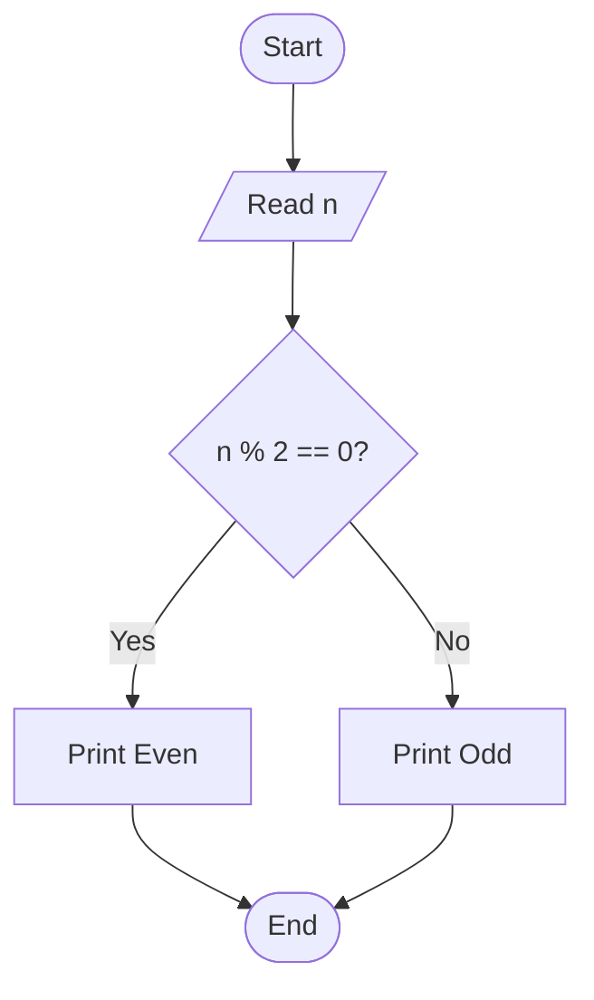

# Flowcharts and Pseudocode

## Learn
- Break the statement into inputs, outputs and constraints.
- Flowchart symbols: terminator, process, input/output, decision and arrows.
- Sequence, selection and iteration.
- Pseudocode indentation, variable naming and dry-run tables.

## Example flow

## Practice
Add two numbers; largest of three; even/odd; multiplication table; factorial; prime check. Write pseudocode and draw the flow before coding.
