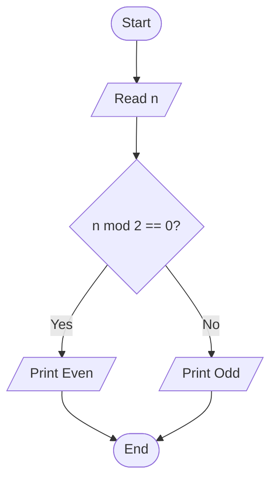

# 00 — Foundations: Learn to Think Before You Code

> **Who this lesson is for:** Someone who is new to programming, has never solved algorithmic problems, or feels unsure how to turn a question into steps. You do not need Java or DSA knowledge yet.

## Learning outcomes

By the end, you should be able to:
- Describe a problem using input, output, rules and constraints.
- Break a large task into small, ordered steps.
- Write language-independent pseudocode.
- Draw or read a basic flowchart.
- Dry-run an algorithm by tracking changing values.
- Find mistakes by testing normal, boundary and unusual cases.
- Explain why a solution is correct in plain language.

## 1. What programming is

A computer does not infer what you *probably* mean. It follows instructions represented in a form it can execute. Programming is the act of designing and expressing those instructions.

A useful mental model is:

**Input → Processing → Output**

Example: given two numbers, produce their sum.

- Input: 7 and 5
- Processing: add them
- Output: 12

The same pattern appears in much larger problems: data is supplied, a sequence of operations transforms or examines it, and a result is produced.

## 2. What is a problem—and what is an algorithm?

A **problem** describes a goal. An **algorithm** is a finite, unambiguous sequence of steps that achieves that goal for valid inputs.

For example, “find the largest number in a list” is a problem. A possible algorithm is:
1. Assume the first value is largest.
2. Examine the remaining values one at a time.
3. If a value is greater than the current largest, replace the current largest.
4. After all values have been examined, return the saved largest value.

The algorithm is not tied to Java. Java is one language in which we can implement it.

### What makes an algorithm useful?

- **Clear:** each step has a definite meaning.
- **Finite:** it eventually stops.
- **Correct:** it produces the required result for valid inputs.
- **Effective:** its operations can actually be carried out.
- **Appropriate:** its time and memory use are reasonable for the input size.

## 3. Specify a problem before solving it

Use this checklist every time you meet a new problem.

| Part | Question to ask |
|---|---|
| Input | What values or data am I given? |
| Output | What exactly must I return, print or construct? |
| Rules | What conditions must the result satisfy? |
| Constraints | How large can the input be? Are values negative, repeated or empty? |
| Example | Can I work out a small example manually? |
| Plan | What simple steps could solve it? |
| Tests | Which cases could expose a mistake? |

### Worked example: determine whether a number is even

**Problem:** Given an integer (n), determine whether it is even.

- Input: one integer (n).
- Output: “Even” if divisible by 2; otherwise “Odd”.
- Rule: an integer is even when the remainder after division by 2 is zero.
- Examples: 8 is even; 7 is odd; 0 is even; -4 is even.

Do not start by memorising code. Start by stating the rule.

## 4. Break a task into smaller steps

This technique is often called **decomposition**.

Suppose the goal is to find the largest of three numbers, (a), (b) and (c).

Rather than trying to write everything at once:
1. Compare (a) with (b).
2. Save whichever is larger.
3. Compare that saved value with (c).
4. Save the larger value.
5. Report the saved value.

Each step is small enough to check independently. This is the same thinking that later helps with functions, recursion and larger algorithms.

## 5. Pseudocode

**Pseudocode** is a readable description of algorithm steps. It is not a programming language and does not require strict syntax. It should be precise enough that a reader can implement it.

### Example: find the largest value in an array

Given: `[4, 9, 2, 7]`

```
largest = first element

FOR each remaining element:
    IF element > largest:
        largest = element

RETURN largest
```

Why begin with the first element instead of zero? Because the array may contain only negative numbers. If we started at zero, we could incorrectly report zero even though zero is not in the array.

**Precondition:** the array contains at least one element. If empty arrays are allowed, the problem must define what the result should be; the algorithm needs a separate handling rule.

## 6. Dry-running: execute the steps by hand

A **dry run** means simulating an algorithm without executing it in a computer. Track variables after each step.

For the largest-element algorithm with `[4, 9, 2, 7]`:

| Step | Element examined | Current largest | Why |
|---|---:|---:|---|
| Start | — | 4 | Initialise with first value |
| 1 | 9 | 9 | 9 is greater than 4 |
| 2 | 2 | 9 | 2 is not greater than 9 |
| 3 | 7 | 9 | 7 is not greater than 9 |

Result: **9**.

When tracing code, create a table for variables. Do not rely on mentally keeping several changing values.

## 7. Flowcharts

A flowchart represents the steps and decisions visually.

Common symbols:
- **Oval:** Start or End.
- **Rectangle:** operation or assignment.
- **Diamond:** decision with outgoing paths such as Yes/No.
- **Parallelogram:** input or output.
- **Arrow:** direction of execution.

### Example: even or odd



A flowchart is helpful for visualising control flow, but it is not required for every problem. Pseudocode is often faster for larger algorithms.

## 8. Tracing and state

**State** means the values that the algorithm's variables currently hold. An assignment changes state.

Example:
```
count = 2
count = count + 1
count = count * 3
```

Trace it:
- Initially, `count = 2`.
- After adding one, `count = 3`.
- After multiplying by three, `count = 9`.

The second line does not mean “count equals count plus one” as a mathematical identity. In programming, it means calculate the right-hand side and store the result in the variable on the left.

## 9. Test cases: don't only test the example

A solution that works for one example may still be wrong. Think of tests as attempts to challenge your assumptions.

For the largest-element problem:

| Test | Expected result | What it checks |
|---|---:|---|
| `[4, 9, 2, 7]` | 9 | Ordinary case |
| `[5]` | 5 | Single element |
| `[-8, -3, -12]` | -3 | All negative values |
| `[4, 4, 4]` | 4 | Duplicate values |
| `[-5, 0, -2]` | 0 | Zero present |
| `[]` | Defined by problem | Empty input contract |

Useful categories:
- **Normal:** representative valid inputs.
- **Boundary:** smallest or largest permitted input.
- **Unusual:** duplicates, negatives, zeros, sorted inputs.
- **Invalid:** only when the problem expects invalid-input handling.

Do not invent a requirement for invalid inputs if the problem guarantees valid input. Instead, follow the stated contract.

## 10. Debugging mindset

When a result is wrong:
1. Reproduce the failure with the smallest input you can.
2. Write down the expected and actual results.
3. Trace each variable.
4. Find the first step where state differs from what you expected.
5. Fix the cause, not just the symptom.
6. Retest the failing case and several other cases.

A debugger can show variable values, but a manual trace is a skill worth developing.

## 11. Beginner practice — attempt before checking solutions

Try to write pseudocode for each task. Draw a flowchart for at least two.

### Level A — Step-by-step logic
1. Describe how to make a cup of tea, including a stopping condition.
2. Read two numbers and calculate their sum.
3. Decide whether an integer is positive, negative or zero.
4. Decide whether an integer is even or odd.
5. Find the larger of two numbers.

### Level B — Decisions and repetition
6. Find the largest of three numbers.
7. Print the integers from 1 through (n).
8. Calculate the sum from 1 through (n).
9. Count how many digits a positive integer contains.
10. Reverse the digits of a positive integer.

### Level C — Working with collections
11. Find the largest value in a non-empty list.
12. Count how many values in a list are even.
13. Determine whether a list contains a target value.
14. Calculate the sum and average of a list.
15. Find both the smallest and largest values in a list.

For each task, record: problem statement, input/output, constraints, pseudocode, dry-run, tests and what you learned.

## 12. Mastery checkpoint

Do not move on just because you read the page. Move on when you can:

- [ ] Explain what an algorithm is without copying the definition.
- [ ] Identify input, output and constraints for a simple problem.
- [ ] Write clear pseudocode for five unseen problems.
- [ ] Dry-run an algorithm with a variable table.
- [ ] Identify at least three useful test cases for a problem.
- [ ] Explain why your algorithm produces the correct result.
- [ ] Draw a flowchart with a decision and a loop.

If you struggle, repeat the exercises. Speed is not the goal at this stage; clarity is.

## 13. What comes next?

Proceed to [Java Basics](../01-Java-Basics/README.md) to turn the ideas in pseudocode into executable programs. Later, revisit these steps when learning complexity, arrays, recursion and graphs—algorithmic thinking is used throughout the course.

---

**Learning principle:** understand the task, create a plan, trace it, test it, and then write code.
