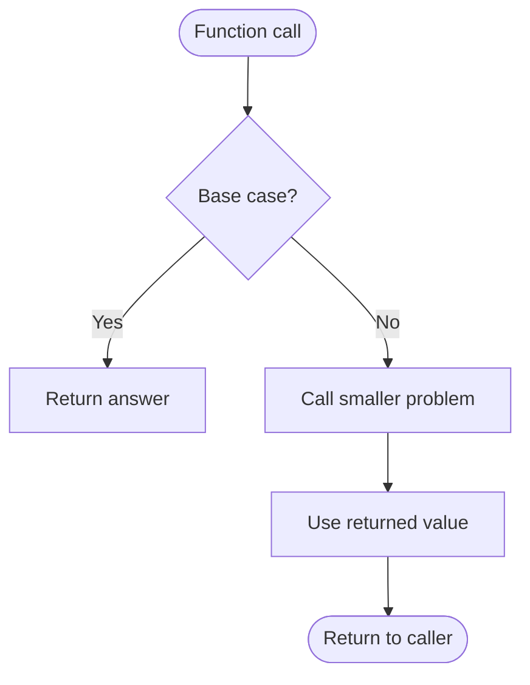

# Recursion

Recursion is divided into two learning parts.

## Part A — Core recursion
- Base case, recursive case and progress toward termination.
- Call stack, stack frames, return flow and recursion tree.
- Print numbers, factorial, sum, Fibonacci and power.
- Array traversal, sorted check, first/last occurrence and reverse.
- Time complexity and recursion-stack space.

## Part B — Recursion patterns
- Subsequences, subsets, permutations and combinations.
- Tiling and friends-pairing recurrence.
- Grid paths and maze problems.
- Choose / explore / unchoose, pruning and backtracking.

## Solved questions
- [Factorial using recursion](FactorialRecursion.java)
- [Power in O(log n)](FastPower.java)
- [First occurrence in an array](FirstOccurrence.java)
- [Binary strings without consecutive 1s](BinaryStrings.java)

## Call flow

